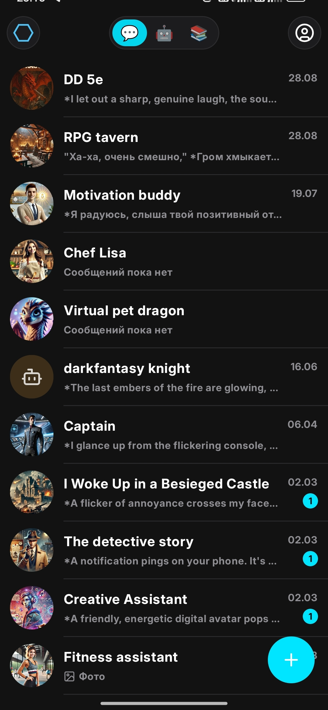
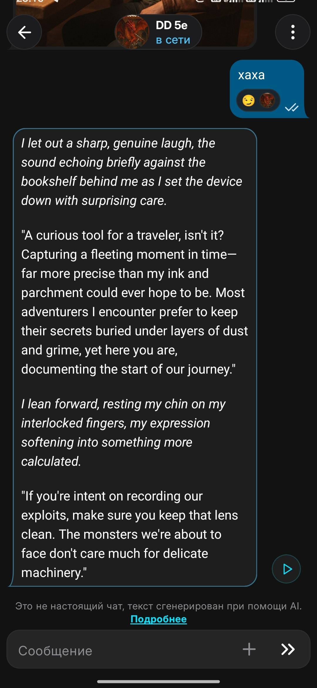
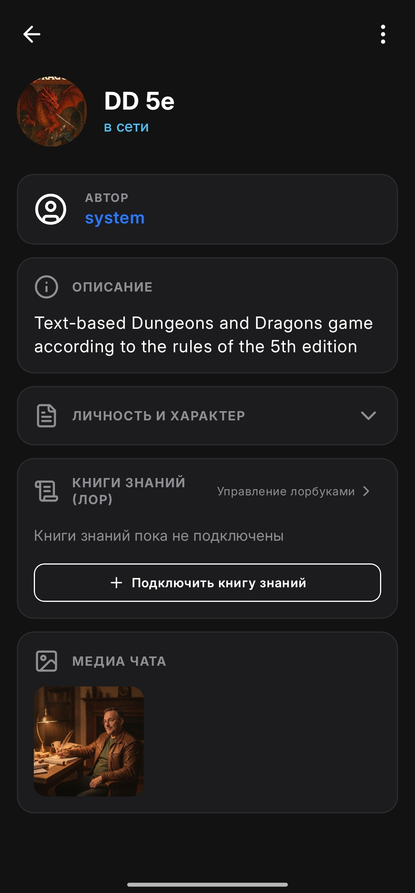

# Avalon Avatars

<p align="center">
  
  
  
</p>

> **Full-Stack Kotlin Multiplatform AI Character Messenger**  
> An open-source, production-grade AI companion messenger built with Kotlin 2.x, Compose Multiplatform, Ktor 3.x, Kotlin-RPC, and Exposed ORM.

[](https://kotlinlang.org)
[](https://www.jetbrains.com/lp/compose-multiplatform/)
[](https://ktor.io/)
[](https://github.com/Kotlin/kotlinx-rpc)
[](LICENSE)

---

## 🌟 Overview

**Avalon Avatars** is an advanced, full-stack AI messenger designed for real-time, immersive interactions with AI characters. It demonstrates clean architecture across a shared monorepo: from multiplatform UI to reactive backend streaming, WebSocket protocol, and AI lorebook evaluation.

Originally developed over 1.5 years as a commercial-grade product, it is now open-sourced to provide the Kotlin and Compose Multiplatform community with a complete, modern reference architecture.

---

## 🏗️ Architecture & Monorepo Structure

The project is organized as a unified Gradle monorepo using **Type-safe Project Accessors** and a centralized Version Catalog (`gradle/libs.versions.toml`):

```text
avalon-chat/
├── gradle/
│   └── libs.versions.toml       # Centralized Version Catalog for all modules
├── shared/                      # Multiplatform Contract Library (JVM, Android, iOS, Wasm)
│   └── src/
│       ├── commonMain/          # RPC interfaces (@Rpc), DTOs, Character Card spec (V2/PNG)
│       └── androidMain/         # Android-specific contract extensions
├── server/                      # Backend Service (Ktor 3.x, Netty, Exposed ORM)
│   ├── src/main/kotlin/         # LLM pipeline (Gemini / OpenRouter), TTS, WebSocket & RPC handlers
│   ├── src/main/resources/      # Flyway DB migrations (PostgreSQL), config
│   ├── Dockerfile               # Production container definition
│   └── docker-compose.yml       # PostgreSQL + Redis setup
├── composeApp/                  # Shared Client UI & Logic (Compose Multiplatform)
│   └── src/
│       ├── commonMain/          # Adaptive UI (MVI), Room/SQLite cache, state management
│       ├── androidMain/         # Android platform integrations (audio, push, permissions)
│       └── wasmJsMain/          # WebAssembly browser client
├── androidApp/                  # Android Application Runner (Launchers, Splash, FCM)
├── benchmark/                   # Macrobenchmark performance testing suite
└── settings.gradle.kts          # Monorepo module orchestration
```

---

## ⚡ Tech Stack

### Client Layer (`:composeApp`, `:androidApp`)
- **UI Framework:** [Compose Multiplatform](https://www.jetbrains.com/lp/compose-multiplatform/) (Android & Wasm).
- **Architecture:** MVI / UDF (Unidirectional Data Flow) with Kotlin Coroutines & `StateFlow`.
- **Local Cache:** Room / SQLite Bundled with OPFS support for Wasm.
- **Dependency Injection:** [Koin Annotations](https://insert-koin.io/).
- **Networking:** Ktor Client & `kotlinx-rpc` over WebSockets.
- **Image Loading:** [Coil 3](https://coil-kt.github.io/coil/).

### Shared Domain Layer (`:shared`)
- **Remote Services:** `kotlinx-rpc` with `@Rpc` annotations.
- **Serialization:** `kotlinx-serialization-json`.
- **Character Specification:** Tavern / Character Card V2 & V3 PNG metadata codec, Lorebook evaluation engine.

### Backend Layer (`:server`)
- **Server Engine:** [Ktor 3.x](https://ktor.io/) on Netty.
- **Database & ORM:** PostgreSQL 17+ with [Exposed ORM](https://github.com/JetBrains/Exposed) (DSL + DAO, strictly asynchronous with suspended transactions).
- **Database Migrations:** Flyway.
- **Cache & Memory:** Lettuce (Redis) & Caffeine.
- **AI Integrations:** Google Gemini SDK (`com.google.genai`), OpenRouter streaming pipeline, Google Cloud Text-to-Speech (TTS).

---

## 🚀 Getting Started

### ⚡ Quick Start on VPS / Server (One-Click)

#### Option 1: Using Pre-built Release Bundle (Recommended — Instant Launch)
Download the pre-compiled server bundle directly from [GitHub Releases](https://github.com/ensodai/avalon-chat/releases) (no Gradle or compilation required):

```bash
mkdir avalon && cd avalon
wget https://github.com/ensodai/avalon-chat/releases/latest/download/avalon-chat-server-linux.tar.gz
tar -xzf avalon-chat-server-linux.tar.gz
chmod +x quickstart.sh
./quickstart.sh
```

#### Option 2: From Source (Git Repository)
```bash
git clone https://github.com/ensodai/avalon-chat.git
cd avalon-chat
chmod +x quickstart.sh
./quickstart.sh
```

The script will automatically:
- Generate secure cryptographic `JWT_SECRET` and PostgreSQL credentials.
- Set up Flyway migrations and initial seed data (providers, models, categories, default characters).
- Start `db`, `redis`, and `server` containers in Docker.

Backend will be available on `http://localhost:8080`.

---

## 📦 Automated Releases & CI/CD (GitHub Actions)

The repository includes a ready-to-use production pipeline (`.github/workflows/release.yml`) triggered by pushing a version tag (e.g. `git tag v1.0.0 && git push origin v1.0.0`) or via manual **Workflow Dispatch** in the GitHub Actions tab.

### Released Artifacts:
1. **`avalon-chat-server-linux.tar.gz`**: Standalone backend bundle (`app.jar`, `Dockerfile`, `docker-compose.yml`, `quickstart.sh`, `.env.example`, and gift assets).
2. **`avalon-chat-android.apk`**: Release Android APK signed with your custom key.
3. **`avalon-chat-web-wasm.zip`**: Production Compose Multiplatform Wasm web client with Service Worker and OPFS SQLite support.

---

### 🤖 Telegram Admin Bot & Security

Avalon Chat includes a built-in admin dashboard for Telegram (`WhiteRTC`-style in-message UI):
- **Dashboard:** Server health, total users, character count, and generated messages.
- **Registration Toggle:** Open or close public registration (`ALLOW_PUBLIC_REGISTRATION=true/false`) on the fly with a single button click to prevent unexpected LLM quota consumption.
- **User Management:** Create accounts (`/create_user <username> [password]`), view user cards, shadow-ban, or promote users to `FREE`, `PREMIUM`, or `ELITE`.

To activate the bot, provide `TELEGRAM_BOT_TOKEN` and your `TELEGRAM_ADMIN_ID` in `.env` and restart the server container:
```bash
docker compose restart server
```

---

### Manual Local Development

#### 1. Setup Environment
```bash
cp .env.example .env
```
Fill in `SPECIAL_GEMINI_KEY` with your Google Gemini API key.

#### 2. Start PostgreSQL & Redis
```bash
docker compose up -d db redis
```

#### 3. Run the Backend
```bash
./gradlew :server:run
```

### 4. Build & Run Clients

#### Web Client (Wasm):
```bash
./gradlew :composeApp:wasmJsBrowserDevelopmentRun
```

#### Android Client:
```bash
./gradlew :androidApp:installDebug
```

---

## 🔒 Security & Privacy Notice

All sensitive tokens, production keystores, and Firebase configurations have been excluded from this public repository. Mock and template files (`.env.example`, `google-services.json.example`) are provided for straightforward local setup.

---

## 📄 License

This project is licensed under the **PolyForm Noncommercial License 1.0.0** — see the [LICENSE](LICENSE) file for details. It permits free personal, educational, research, and noncommercial use, modification, and distribution. Commercial use requires a commercial license agreement with the author.
